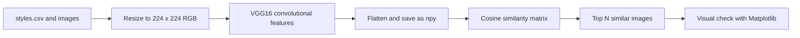

<div align="center">

# Fashion Image Search Engine

**Content-based image retrieval for fashion products: VGG16 features and cosine similarity find the items that look most like a query image.**

[](LICENSE)


</div>

This practice project builds a visual search engine for fashion product photos. A pre-trained convolutional network turns every image into a feature vector, and similar products are retrieved by comparing those vectors with cosine similarity. The whole workflow lives in one Jupyter notebook, including a visual check of the results.

## Table of Contents

- [Overview](#overview)
- [Key Features](#key-features)
- [How It Works](#how-it-works)
- [Tech Stack](#tech-stack)
- [Project Structure](#project-structure)
- [Dataset](#dataset)
- [Getting Started](#getting-started)
- [Usage](#usage)
- [Evaluation](#evaluation)
- [Limitations](#limitations)
- [Acknowledgements](#acknowledgements)
- [License](#license)
- [Author](#author)

## Overview

Given the index of a product image, the engine returns the indices of the most visually similar products in the catalogue. No model is trained: the VGG16 network, with weights pre-trained on ImageNet, is used as a fixed feature extractor, and retrieval is a nearest-neighbour search in feature space.

## Key Features

- Reads the product metadata (`styles.csv`) and finds the image file of each product (`<id>.jpg`).
- Standardises every image: RGB conversion and resizing to 224 by 224 pixels.
- Extracts features with VGG16 without its classification head (`include_top=False`) and flattens them into one vector per image.
- Saves the feature extractor (`vgg16_feature_extractor.keras`) and the feature matrix (`extracted_features.npy`) so that searches do not need to reprocess the images.
- Computes the cosine similarity between all image pairs and returns the top results for a query index with `get_similar_images`.
- Shows a query image next to its top ten results (the first result is the query itself) with Matplotlib for visual verification.

## How It Works



1. **Dataset preparation.** Load `fashion-dataset/styles.csv`, keep only the products whose image exists in `fashion-dataset/images/`, load each image as an RGB array of 224 by 224 pixels. The notebook also estimates the processing time from a sample of ten images.
2. **Feature extraction.** Apply `preprocess_input` from VGG16 and predict with the convolutional part of the network. The output of each image is flattened to a single vector.
3. **Search.** Compute `cosine_similarity` over the feature matrix and sort the similarities of the query row in descending order. The first result is the query itself.
4. **Verification.** `show_images` plots the query and its neighbours in a row.

## Tech Stack

| Area | Technology |
|------|------------|
| Language | Python 3 |
| Deep learning | TensorFlow / Keras, VGG16 pre-trained on ImageNet |
| Similarity | scikit-learn (`cosine_similarity`) |
| Data and images | pandas, NumPy, Pillow |
| Visualisation | Matplotlib |
| Environment | Jupyter Notebook |

## Project Structure

```text
.
├── image_recognition.ipynb   # Complete workflow: preparation, features, search, visual check
├── requirements.txt          # Dependency list (see the note in Getting Started)
├── LICENSE
└── README.md
```

Files created when the notebook runs, and not stored in the repository: `vgg16_feature_extractor.keras` and `extracted_features.npy`.

## Dataset

- **Source:** [Fashion Product Images Dataset on Kaggle](https://www.kaggle.com/paramaggarwal/fashion-product-images-dataset), by Param Aggarwal.
- **Not included in the repository:** the full dataset is large (about 25 GB according to the original project notes).
- **Expected layout:** the notebook reads `fashion-dataset/styles.csv` and the images in `fashion-dataset/images/`, relative to the notebook.
- **Size seen in the notebook:** 44,419 product images found for the metadata rows.

## Getting Started

### Prerequisites

- Python 3 with `pip`
- A Kaggle account to download the dataset
- Substantial disk space and RAM. The saved run took roughly 35 minutes to load and resize the images and about 44 minutes to extract the features on the machine that ran it, and the notebook keeps the full similarity matrix of all images in memory, which needs several gigabytes.

### Installation

```bash
git clone https://github.com/LargoLujan/fashion_image_search_engine.git
cd fashion_image_search_engine
python -m venv .venv
source .venv/bin/activate        # On Windows: .venv\Scripts\activate
pip install numpy pandas matplotlib pillow scikit-learn tensorflow jupyter
```

`requirements.txt` pins `tensorflow==2.3.0`, which is much older than the TensorFlow version shown in the saved notebook output (2.16.1) and cannot load models saved in the `.keras` format that the notebook uses. Use a recent TensorFlow as in the command above.

### Data

Download the dataset from Kaggle and extract it so that the folder structure is:

```text
fashion-dataset/
├── styles.csv
└── images/
    ├── 10000.jpg
    └── ...
```

### Running

```bash
jupyter notebook image_recognition.ipynb
```

The first cell of the notebook runs `!pip install tensorflow`. Run the cells in order; the feature extraction step is the slowest.

## Usage

After the features exist, a search is a call to `get_similar_images`:

```python
index_of_query_image = 15
similar_indices = get_similar_images(index_of_query_image, num_results=10)
image_paths = [image_files[index_of_query_image]] + [image_files[i] for i in similar_indices]
show_images(image_paths, main_title="Query and Similar Images")
```

Indices refer to positions in the list `image_files`, which follows the order of the rows in `styles.csv`. The notebook's saved example for index 0 returns `[0, 32845, 3899, 35075, 35592, 9567, 38293, 31272, 7055, 27726]`, where the first entry is the query itself.

## Evaluation

Retrieval quality is judged visually: the notebook plots a query next to its top ten results so that the user can check whether they look alike. No quantitative retrieval metric (such as precision at k) is computed.

## Limitations

- The features are generic ImageNet features, not trained on fashion, and the flattened convolutional output is large.
- Similarity is computed between all image pairs at once, so memory grows with the square of the catalogue size; a large catalogue would need an approximate nearest-neighbour index or batched search.
- Product metadata (category, colour and so on) is loaded but not used to filter or rank results.

## Acknowledgements

- Param Aggarwal for publishing the Fashion Product Images Dataset on Kaggle.
- The Keras VGG16 architecture and ImageNet pre-trained weights.

## License

Distributed under the MIT License. See [LICENSE](LICENSE) for details.

## Author

**Manuel Luján Vílchez** — Senior Data Engineer

[](https://github.com/LargoLujan)
[](https://www.linkedin.com/in/manuel-lujan-vilchez)
